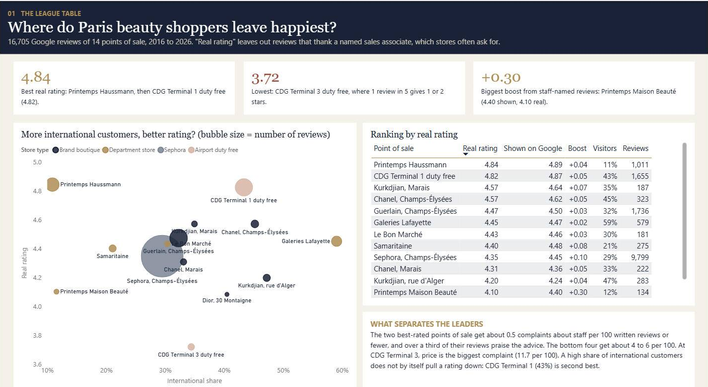
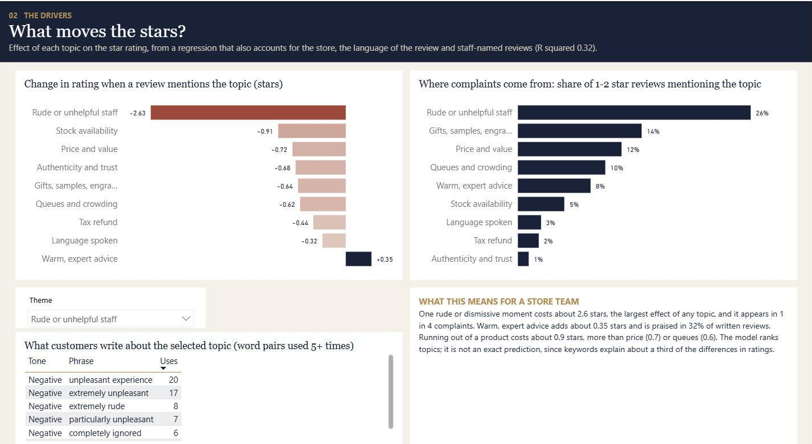
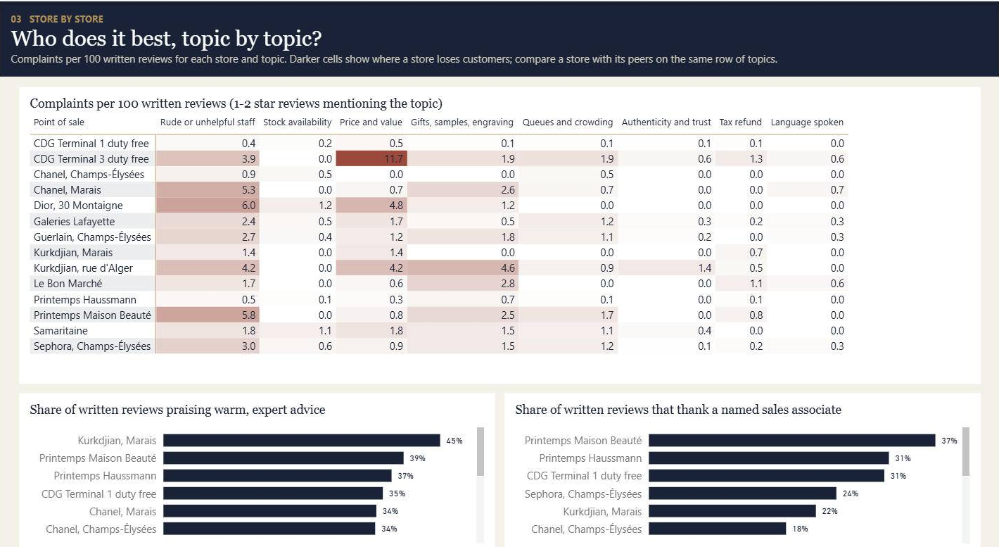
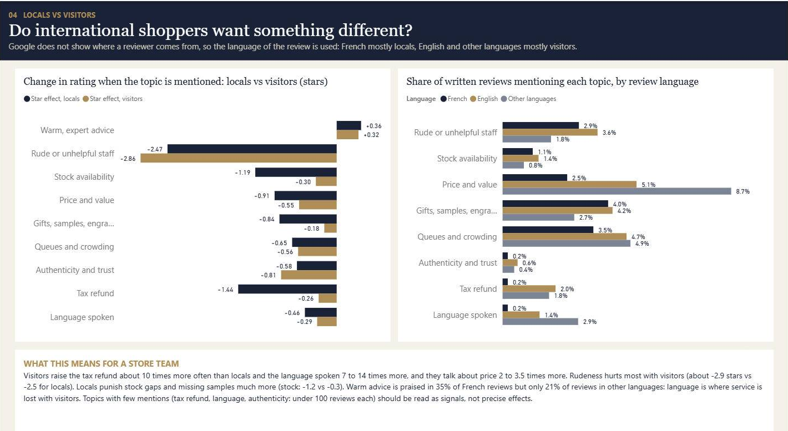
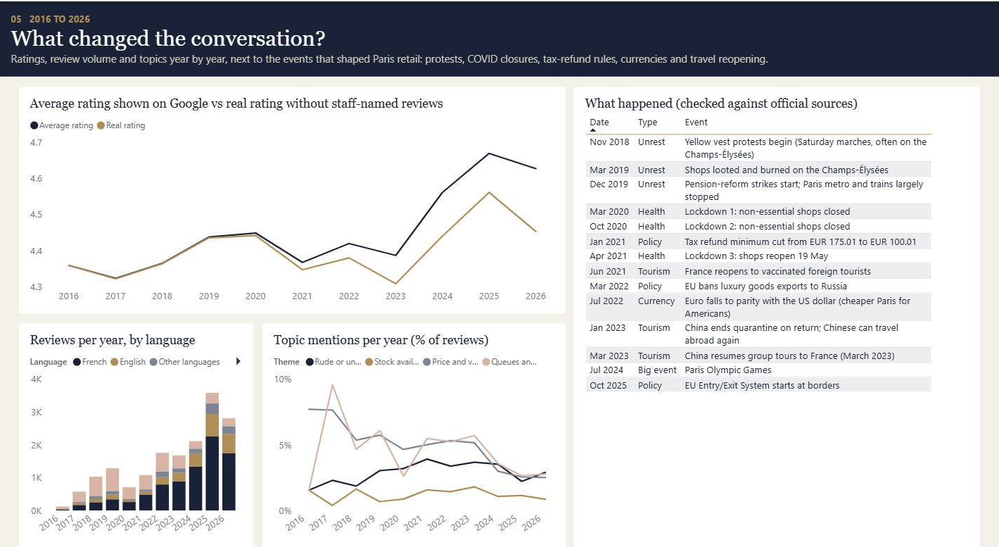

# What shoppers say about Paris luxury beauty stores

16,705 Google reviews of 14 Paris points of sale for luxury beauty and fragrance, 2016 to 2026: brand boutiques, department stores, Sephora on the Champs-Élysées and the Charles de Gaulle airport duty free shops. The question behind the project is simple: **what makes a beauty shopper leave a Paris store happy, and what sends them away angry?**

The answer is written for a retail or market intelligence team: which stores lead, which topics move the star rating, how visitors differ from locals, and how the picture changed through the protests, COVID, tax-refund rules and the return of tourists.



## Key findings

1. **Staff decide the rating.** A review that mentions rude or unhelpful staff scores about 2.6 stars lower, the largest effect of any topic, and it shows up in 1 in 4 complaints. Warm, expert advice is the only topic that lifts the rating (+0.35 stars), and it is praised in 32% of written reviews.
2. **Stock gaps cost more than price.** Running out of a product costs about 0.9 stars, more than price (0.7) or queues (0.6).
3. **The leaders are the calmest stores, not the most local ones.** Printemps Haussmann (4.84) and CDG Terminal 1 duty free (4.82) get about 0.5 staff complaints per 100 written reviews; the bottom four get 4 to 6. CDG Terminal 1 has 43% international reviewers and is still second, so tourists are not what pulls a rating down.
4. **Visitors want different things.** Reviews in English and other languages mention the tax refund about 10 times more often than French reviews, the language spoken 7 to 14 times more, and price 2 to 3.5 times more. Warm advice is praised in 35% of French reviews but only 21% of reviews in other languages.
5. **Google ratings are drifting up for a reason that is not service.** Reviews that thank a named sales associate went from under 1% of reviews before 2020 to about a third in 2026, and stores often ask for them. Without them, the 2026 rating is 4.45 instead of 4.63, close to the 2019 level.

## The dashboard

A five-page Power BI report, built to be read like a short briefing rather than a set of charts.

| Page | Question it answers |
|---|---|
| 1. League table | Where do Paris beauty shoppers leave happiest? |
| 2. Drivers | What moves the stars, and what do customers actually write? |
| 3. Store by store | Who does it best, topic by topic? |
| 4. Locals vs visitors | Do international shoppers want something different? |
| 5. Over time | What changed the conversation from 2016 to 2026? |






The report reads its data from the CSV files in `data/` on this repository, so it opens and refreshes without any local files. Download `powerbi/Paris_Beauty_Shopper_Reviews.zip`, unzip it and open the `.pbip` file in Power BI Desktop.

## Where the data comes from

**Source.** Public Google Maps reviews, the place where most shoppers rate a store after a visit. No store visits, surveys or paid data were used.

**Choosing the points of sale.** 14 Paris points of sale that sell luxury perfume and make-up, chosen to cover the four ways a shopper can buy: brand boutiques, department stores, Sephora on the Champs-Élysées and the Charles de Gaulle airport duty free shops. Each one was identified on Google Maps by its unique place ID, so reviews of a different branch with the same name cannot slip in.

**Collecting.** The reviews were collected on 22 November 2026 with the Apify actor [`kaix/google-maps-reviews-scraper`](https://apify.com/kaix/google-maps-reviews-scraper), a tool that reads the public reviews of a Google Maps place. The settings were:

| Setting | Value | Why |
|---|---|---|
| Places | 14 Google place IDs | One exact location per store |
| Period | Reviews published from 1 January 2016 | Long enough to see the protests, COVID and the return of tourists |
| Number of reviews | All available | No sampling |
| Language | English translation added by Google, original language kept | One language for keyword analysis, the original to tell locals from visitors |
| Region | France | Paris listings as French shoppers see them |
| Search keywords (department stores) | perfume, parfum, fragrance, makeup, maquillage, cosmetics, beauty, beauté, 香水 | These stores also sell fashion, food and homeware |

For each review the tool returns the date, the star rating, the original language, the text, Google's translation and whether the store replied. Reviewer names, profiles and photos were not kept. The run cost less than one US dollar on Apify's pay-per-result pricing.

**Cleaning.** For Dior 30 Montaigne and the four department stores, a second check keeps only reviews whose text talks about beauty (perfume, fragrance, make-up, cosmetics, skincare, lipstick, foundation, serum, Sephora). Brand boutiques, Sephora, Printemps Maison Beauté and the duty free shops sell beauty only, so all their reviews are kept.

| Step | Reviews |
|---|---|
| Collected (Jan 2016 to Nov 2026) | 18,695 |
| Kept after the beauty check | 16,705 |
| With written text (used for topics) | 12,502 |

| Point of sale | Type | Reviews kept | With text |
|---|---|---:|---:|
| Sephora, Champs-Élysées | Sephora | 9,799 | 6,673 |
| Guerlain, Champs-Élysées | Brand boutique | 1,736 | 1,131 |
| CDG Terminal 1 duty free | Airport duty free | 1,655 | 1,564 |
| Printemps Haussmann | Department store | 1,011 | 1,011 |
| Galeries Lafayette Haussmann | Department store | 579 | 579 |
| Chanel, Champs-Élysées | Brand boutique | 323 | 219 |
| Maison Francis Kurkdjian, rue d'Alger | Brand boutique | 283 | 216 |
| Samaritaine | Department store | 275 | 275 |
| CDG Terminal 3 duty free | Airport duty free | 236 | 154 |
| Chanel, Marais | Brand boutique | 222 | 151 |
| Maison Francis Kurkdjian, Marais | Brand boutique | 187 | 143 |
| Le Bon Marché | Department store | 181 | 181 |
| Printemps Maison Beauté | Department store | 134 | 121 |
| Dior, 30 Montaigne | Brand boutique | 84 | 84 |

Of the written reviews, 68% are in French, 21% in English and 11% in other languages (Spanish, Arabic, Russian, Portuguese and others).

**What is published.** The raw reviews stay private, in line with Google's terms and reviewers' privacy. This repository only holds the aggregated tables in `data/`: counts, averages and two-word phrases used at least 5 times.

**Context events.** The 14 events on the timeline (protests, lockdowns, the tax-refund threshold cut, euro–dollar parity, China reopening, the Olympics, the EU Entry/Exit System) were each checked against a public source (government and EU sites or established news outlets), with the link for each one in `data/events.csv`.

## How it was done

**1. Collect and clean.** As described above, in `notebooks/01_prepare_reviews.ipynb`.

**2. Tag.** Each written review is tagged with nine topics using keyword rules (for example "rude", "ignored", "no one came" for rude or unhelpful staff). Reviews that thank a sales associate by name are flagged separately. The language of the original review is used to separate likely locals (French) from likely visitors (English and other languages).

**3. Measure.** A linear regression of the star rating on the nine topics, controlling for the store, the review language and staff-named reviews, gives the effect of each topic in stars. It explains about a third of the variation in ratings (R squared 0.32), so it is used to rank topics, not to predict a rating. The most common word pairs for each topic show how customers phrase it.

**4. Add context.** The checked events are placed next to the yearly trends on the Over time page.

| Notebook | What it does |
|---|---|
| `notebooks/01_prepare_reviews.ipynb` | Cleans the reviews, names the stores, keeps beauty reviews, sets tone and language groups |
| `notebooks/02_themes_and_trends.ipynb` | Tags topics and staff-named reviews, builds the store, yearly and topic tables |
| `notebooks/03_drivers_and_phrases.ipynb` | Regression of rating on topics (all, locals, visitors) and the most used phrases |

Tools: Python (pandas, scikit-learn, matplotlib), Apify, Power BI.

## What the data does not show

- **Language is a stand-in for nationality.** Google does not show where a reviewer lives. Some French reviews come from visitors and some English reviews from Paris residents.
- **Reviewers are not all shoppers.** People who post reviews are more often very happy or very unhappy, and stores that ask for reviews get more positive ones.
- **Keyword tagging is simple.** It catches clear wording and misses irony or unusual phrasing. The rules were tightened after reading tagged reviews (for example, "can't wait to come back" is not a complaint about queues).
- **Small topics are signals.** Tax refund, language and authenticity each appear in fewer than 100 reviews, so their effects are less precise.
- **Only totals are published.** The `data/` folder holds counts, averages and short word pairs. No review text, reviewer names or individual reviews are shared, in line with Google's terms.

## Repository

```
data/          summary tables used by the dashboard
notebooks/     the three analysis notebooks
powerbi/       the Power BI project (zip)
images/        dashboard screenshots
BRIEF.md       one-page recommendations for a store or brand team
```

## About me

I'm Athul, a student in International Management and Business Intelligence at ESCE Paris, with a background in mechanical engineering and two years in operations at Vedanta. I build projects around business questions in European retail and luxury.

[LinkedIn](https://www.linkedin.com/in/thekkinkattil-athul)
